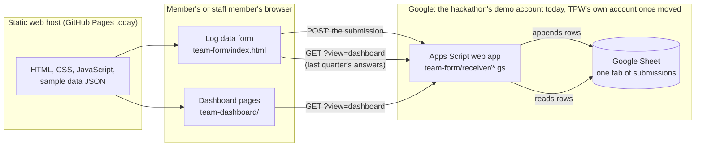

# Technical guide: how the TPW data tool works

This guide is for the developer taking the tool over, and for any AI coding agent working with them. It explains every part of the system, how the parts talk to each other, and how to set up, change and test each one. Read it top to bottom once. After that, use the headings to jump around.

The tool is a working prototype, not yet ready for real member data. [`go-live-checklist.md`](go-live-checklist.md) lists what has to change before members submit real numbers. The short version: it has no real sign-in yet.

## Contents

1. [What the tool does](#1-what-the-tool-does)
2. [The whole system on one page](#2-the-whole-system-on-one-page)
3. [The tech stack](#3-the-tech-stack)
4. [Which folders matter](#4-which-folders-matter)
5. [The Google Apps Script back end](#5-the-google-apps-script-back-end)
6. [The Google Sheet](#6-the-google-sheet)
7. [The website](#7-the-website)
8. [Hosting and publishing](#8-hosting-and-publishing)
9. [Running and testing it on your own computer](#9-running-and-testing-it-on-your-own-computer)
10. [Working on it with an AI agent](#10-working-on-it-with-an-ai-agent)

## 1. What the tool does

TPW's member organizations run programs inside California state prisons. Each quarter, TPW asks them for four numbers per program: the program's name, how many people took part, the course hours, and how many people completed it. Members also say which prisons (the form calls them "facilities") and which yards each program runs at.

The tool has two halves:

- **A form** ("Log data"), where a member enters those numbers. The second time a member files, the form fills in their prisons, yards and programs from last time, so they only type the new numbers.
- **A dashboard**, where TPW staff (and each member, for their own organization) see the totals, a chart over time, and estimates of sentence-reduction credit days.

Every submission is stored as rows in one Google Sheet. There is no other database. Today that Sheet is in a demo Google account the hackathon team made (see [3.1](#31-the-accounts-it-runs-on-today)). Before real use, TPW makes its own copy in its own account ([5.9](#59-setting-up-tpws-own-copy-from-scratch)).

## 2. The whole system on one page



What happens when a member submits:

1. The browser loads the form's files from the web host. Nothing on the web host ever changes after publishing.
2. The member fills in the form. The browser checks the answers as they go.
3. On **Finish and submit**, the browser sends the answers as one JSON message to the Apps Script web app's address.
4. The Apps Script checks everything again, turns the submission into one row per program per yard, and appends the rows to the Sheet.
5. It replies with a short reference (the Submission ID, for example `58FE0780`). The form shows "Submitted to TPW: 6 rows, reference 58FE0780."

What happens when someone opens the dashboard:

1. The browser asks the same Apps Script address for `?view=dashboard`.
2. The Apps Script reads every row of the Sheet, groups the rows back into submissions, and returns them as JSON.
3. The browser adds the made-up sample organizations (see [7.5](#75-the-dashboards)), works out the totals and draws the pages.

## 3. The tech stack

| Part | What it's built with | Where it lives |
|---|---|---|
| Website | Plain HTML, CSS and JavaScript modules. No framework, no build step, no npm packages. | This repository |
| Hosting | GitHub Pages, published by a GitHub Actions workflow on every push to `main` | `.github/workflows/pages.yml` |
| Back end | One Google Apps Script project, published as a web app | `team-form/receiver/` (source), Google's Apps Script editor (live copy) |
| Database | One tab of one Google Sheet | The Google Drive of the account that owns it: the hackathon's demo account today (3.1) |
| Helper scripts | Python 3, standard library only | `scripts/` |
| Tests | Node.js 22 (no packages), Python 3, and headless Chrome for the browser tests | `team-form/test/`, `members/test/`, `admin/*/test*`, `scripts/test_*.py` |

There is no server you run, no database server, no paid service, and no API keys or passwords anywhere in the repository. The two web addresses in the code (the Apps Script address and the Sheet's address) are public settings, not secrets: the Sheet itself is only open to the Google accounts it is shared with.

The project was kept this simple on purpose. TPW has a small staff and no developer on hand day to day, so every moving part is something Google or GitHub runs and keeps running.

### 3.1 The accounts it runs on today

The tool was built in accounts the hackathon team made or already had. None of it is in a TPW account yet. Moving it is item 1 on the [go-live checklist](go-live-checklist.md).

**The demo Google account, `tpwhackathondemodemo@gmail.com`.** The team made this free Gmail account during the hackathon, so the back end wouldn't run inside anyone's personal or work account. It owns the whole Google side:

| What | Where to find it | What in the code points at it |
|---|---|---|
| The Google Sheet, "TPW guided form submissions (App Script)" | The demo account's Google Drive. Its ID is `1iUR7q0qnq3RLq33cwIZraRjJn0YWaY1PM0btTKMH7Q0`. | The receiver's `SPREADSHEET_ID` setting (5.3) and `team-dashboard/raw-data.html` |
| The Apps Script receiver ([section 5](#5-the-google-apps-script-back-end)) | <https://script.google.com>, signed in as the demo account. It was created on 24 October 2026 as "TPW guided form receiver (TEST)". | Its web app address, in `team-form/backend.js` |

What that means in practice:

- **Both web apps run as the demo account.** That's how they can write to a Sheet members can't open (5.1). It also means that if the demo account is deleted, or Google suspends it, submissions and the dashboards stop working at once.
- **Who can open the Sheet:** the demo account, plus six hackathon team members' Google accounts as editors. It isn't shared by link ("Restricted"). Checked on 25 October 2026.
- **Who can sign in to the demo account:** Thomas Manandhar-Richardson of Vegan Hacktivists made it, and its sign-in was shared within the hackathon team. The password isn't in this repository and never should be. Ask him for access while you move things over.
- **Don't adopt the demo account as TPW's.** Its sign-in went round a hackathon team, so start fresh in a TPW account instead (5.9).
- **Switch the old addresses off afterwards.** Once TPW's copy is live and `team-form/backend.js` points at it, sign in as the demo account and archive both web apps: **Deploy** → **Manage deployments** → select the web app → **Archive**. Until then, the old addresses keep accepting submissions from anyone and keep answering the dashboard feed (go-live checklist, items 3 and 4).

**Don't confuse it with the website's "demo accounts".** Org 1, Org 2 and TPW staff, picked under **Members Login**, aren't Google accounts or any other kind of account. They're labels the browser keeps ([7.4](#74-shared-code-and-the-demo-sign-in)).

**The code and the web address.** The repository is `Avery2/tpw-hackathon`, in a hackathon team member's personal GitHub account. The site is published at averychan.site, that team member's own web address ([section 8](#8-hosting-and-publishing)).

**An old Firebase project.** The earlier form and dashboard (`form-demo/` and `dashboard/`, section 4) saved submissions to Firebase, a Google database service, in a project called `tpw-hackathon` that belongs to another team member. The live tool doesn't use it. It still holds old test submissions, so ask the hackathon team to delete it.

## 4. Which folders matter

The repository holds the live tool plus older experiments that are no longer used. The older parts still work and still have tests, but nothing members see depends on them.

**The live tool:**

| Path | What it is |
|---|---|
| `team-form/index.html` | The form. One HTML file with its own CSS and JavaScript. |
| `team-form/backend.js` | The Apps Script web app's address. One line. |
| `team-form/js/` | `reporting-period.js` (which quarter it is, in California time) and `last-quarter.js` (builds last quarter's answers into a starting point). |
| `team-form/receiver/` | **The Apps Script back end**: the source of every file in the live Apps Script project. See [section 5](#5-the-google-apps-script-back-end). |
| `team-form/test/` | Tests for the back end, the quarter logic, the dashboard data and the form in a real browser. |
| `intake/simple.html`, `intake/js/simple.js` | "Log data": the page members open. It shows TPW's header and loads the form in a frame. |
| `team-dashboard/` | The dashboard pages: Overview (`index.html`), Programs, Organizations (TPW staff only), Submissions, and Data (TPW staff only). JavaScript in `team-dashboard/js/`. |
| `assets/` | Code every page shares: the header, footer and member bar (`site-shell.js`), the demo sign-in (`member-session.js`), the account menu (`account-drawer.js`) and the one place dashboards load data from (`dashboard-source.js`). |
| `data/demo/dashboard-sample.json` | Two made-up organizations (Org 1 and Org 2) and their made-up submissions, so the dashboard has something to show. Always labelled "Sample data" on screen. |
| `data/public/tpw-members.csv` | TPW's public member list. The form suggests these names as the member types, so one organization isn't filed under several spellings. |
| `report/` | Prebuilt annual report PDFs (one for TPW, one per sample organization) linked from the member bar. |
| `index.html` | The front page. |
| `site/` | An offline copy of thetpw.org, so the demo can show the tool inside TPW's own site. Not needed once the tool is embedded in the real thetpw.org. |
| `members/` | An old entry address that now forwards to Log data. Its `test/` folder checks the demo sign-in and menus. |
| `scripts/build_site.py` | Builds the folder that gets published (see [section 8](#8-hosting-and-publishing)). |
| `.github/workflows/` | `pages.yml` publishes the site; `tests.yml` runs the tests on every push. |

**Older parts, not used by the live tool** (safe to delete once you're comfortable):

| Path | What it was |
|---|---|
| `form-demo/`, `dashboard/` | An earlier form and dashboard that stored data in Firebase. Their pages now only forward to `team-form/` and `team-dashboard/`. |
| `admin/sheetforms/`, `admin/steward/` | An earlier Apps Script receiver and a staff console. Nothing sends data to them. |
| `intake/index.html`, `intake/sheet.html`, `intake/scan.html`, `intake/upload.html` | Retired pages (a printable roster, a sheet scanner, a document upload). They now forward to Log data. |
| `data/intake/`, `scripts/intake_*.py`, `scripts/standard_rollup.py`, `scripts/build_additional_forms.py`, `.github/workflows/intake.yml` | An earlier design that stored each filing as a file in this repository. Kept for history; new submissions never go there. |
| `report/build.py`, `scripts/build_organization_reports.py` | Build the report PDFs from the older CSV export and the sample data, not from the live Sheet. |

## 5. The Google Apps Script back end

### 5.1 What Apps Script is, if you haven't used it

Google Apps Script runs JavaScript on Google's servers, inside a Google account. You write it in Google's online editor at <https://script.google.com>. A script can be **deployed as a web app**: Google gives it a public address ending in `/exec`, and calls the script's `doGet(e)` function for every GET request to that address and `doPost(e)` for every POST request.

The important trick here: the web app runs **as the Google account that deployed it**. So the script can write to a Sheet that only that account can open, while the people submitting the form never get access to the Sheet. Members don't need a Google account at all.

Things that behave differently from a normal Node.js server:

- **All `.gs` files share one global scope**, as if they were one file. A function defined in `Rows.gs` can be called from `Code.gs` without any import.
- **Function names ending in `_` are private.** Google won't let a web page call them directly, and the editor hides them from its Run menu. Every helper here ends in `_` for that reason.
- **No state survives between requests** except what you store: the Sheet, Script Properties (settings), and the script cache (`CacheService`, short-lived, at most 6 hours).
- **Saving code doesn't change the live web app.** The `/exec` address keeps running the version you last *deployed*. See [5.10](#510-changing-the-script-safely).
- **Every reply is HTTP 200.** The script can't send other status codes. Success and failure are in the JSON body, in its `ok` field.

### 5.2 The project's files

The live project has six files. Their exact contents are in `team-form/receiver/`. The repository is the master copy: change files here, test them, then copy them into Google.

| File | What it does |
|---|---|
| `appsscript.json` | The project's settings, called the manifest: time zone (America/Los_Angeles), the JavaScript engine (V8), the Google Sheets API it uses, the one permission it asks for (read and write Sheets), and how the web app runs ("as the deploying account", open to "anyone, even without a Google account"). |
| `Code.gs` | The entry points. `doGet` answers capability checks and the dashboard feed. `doPost` takes submissions. `handleSubmission_` runs the whole save (section 5.5). It also maps values onto the Sheet's columns by heading name and adds two extra columns when missing. |
| `Rows.gs` | The rules. `buildRows` checks a submission and turns it into Sheet rows, one per program per yard. It also holds the column headings (`HEADER`), the list of 31 prisons (`FACILITIES`) and the limits (`LIMITS`). It never talks to Google, so the tests run it in plain Node. |
| `Sheet.gs` | Talks to the Sheet: which tab (`TAB`), which spreadsheet (`SPREADSHEET_ID` setting), creates the tab and heading row if missing, and appends rows. |
| `Dashboard.gs` | The dashboard feed (`?view=dashboard`). Reads every row and groups rows back into submissions (section 5.7). |
| `Session.gs` | The hand-over point for sign-in, which isn't built yet. It stores and looks up "passes" that say which organization a signed-in person belongs to (section 5.8). |

### 5.3 Settings (Script Properties)

These live in the Apps Script editor under **Project Settings** (the gear icon) → **Script Properties**. They are not in the repository.

| Property | Value | What it does |
|---|---|---|
| `SPREADSHEET_ID` | The long ID in the Sheet's address, between `/d/` and `/edit` | Which Google Sheet to write to and read from. Required. |
| `ALLOW_UNSIGNED` | `true`, or absent | While `true`, anyone can submit without signing in, and the organization name comes from the form. Without it, every submission is refused with "Please sign in again". **It is `true` today, because sign-in isn't built.** Remove it (or set it to anything else) once sign-in works. |
| `TEST_DATA` | `yes`, or absent | While `yes`, every new row is marked `Yes` in the Sheet's **Test data** column, and the dashboards badge it as sample data. Absent means `No`. Use `yes` while testing; remove it before real members file. |

### 5.4 The web app's three requests

All three go to the one address in `team-form/backend.js`, which ends in `/exec`.

**1. Capability check: `GET /exec`**

Returns what this version of the script supports. The form asks for it before sending program notes, so an older script can never silently drop them.

```json
{ "ok": true, "service": "TPW guided form submissions", "formVersion": 2,
  "features": { "programNotes": true, "currentQuarter": true, "additionalData": true,
                "headerRecovery": true, "dashboard": true, "testData": true } }
```

Opening the address in a browser is the quickest way to check the web app is up.

**2. Dashboard feed: `GET /exec?view=dashboard`**

Returns every submission in the Sheet. Add `&org=<id>&name=<name>` to get one organization's submissions only (for example `&org=org-1&name=Org%201`).

```json
{ "ok": true,
  "orgs": [ { "id": "org-1", "name": "Org 1" } ],
  "submissions": [ {
    "id": "58FE0780",
    "organization": "Org 1",
    "orgId": "org-1",
    "submittedAt": "2026-10-25T22:32:10.000Z",
    "reportingPeriod": { "quarter": 4, "year": 2026 },
    "previousSubmissionId": "A96FB597",
    "testData": true,
    "prisons": [ { "code": "SQ", "name": "San Quentin Rehabilitation Center (SQ)", "yards": ["North"] } ],
    "programs": [ {
      "id": "a1b2c3", "name": "Mindfulness", "status": "Completed",
      "startDate": "2026-09-01", "endDate": "2026-10-01", "courseHours": 20, "notes": "",
      "participants": 10, "participantsCompleted": 4,
      "assignments": [ { "code": "SQ", "yards": ["North"] } ]
    } ]
  } ] }
```

A program's `participants` and `participantsCompleted` are its yards added together. The feed never returns the **Submitted By** email or anything about sign-in.

**Warning: this feed is open to anyone who has the address, and the address is in the public website's code.** Anyone can read every organization's numbers through it, without access to the Sheet. That's acceptable only while the Sheet holds made-up data. Closing it is on the go-live checklist.

**3. Submission: `POST /exec`**

The body is JSON, sent with the header `Content-Type: text/plain;charset=utf-8`:

```json
{ "token": "",
  "payload": {
    "submissionId": "3f1c2a9e-5b7d-4c11-9a0e-2d4f6b8c0a12",
    "organization": "Org 1",
    "reportingPeriod": { "quarter": 4, "year": 2026 },
    "orgId": "org-1",
    "previousSubmissionId": "A96FB597",
    "programs": [ {
      "id": "a1b2c3",
      "name": "Mindfulness",
      "notes": "",
      "status": "Completed",
      "startDate": "2026-09-01",
      "endDate": "2026-10-01",
      "courseHours": 20,
      "sites": [ { "facilityCode": "SQ", "yard": "North", "participants": 10, "completed": 4 } ]
    } ]
  } }
```

- `token` is the sign-in pass. Empty today.
- `payload.submissionId` is a random ID the browser makes. The same ID on a retry means "this is the same submission", so a reply lost on the way back can't file the quarter twice. The form makes a new ID whenever the answers change.
- `orgId` and `previousSubmissionId` are only there when the form was filled in from last quarter.
- `reportingPeriod` is ignored: the script decides the quarter itself (section 5.5, step 4).

The reply on success:

```json
{ "ok": true, "submissionId": "58FE0780", "rows": 6, "organization": "Org 1", "signedIn": false }
```

On failure, nothing is written and the reply lists the problems:

```json
{ "ok": false, "errors": [ "Program 2: the end date is before the start date." ] }
```

If a pass was required and missing, the reply also has `"signInNeeded": true`.

**Why `text/plain`?** A browser sending JSON to another website first sends a permission check (a "CORS preflight", an `OPTIONS` request). Apps Script web apps can't answer that check. Sent as plain text, the browser skips the check, and the script reads the body as JSON anyway. Don't change the content type.

**The redirect.** Google answers every `/exec` request with a redirect to a `script.googleusercontent.com` address, which holds the actual reply. `fetch` follows it automatically. If you call the address with `curl`, add `-L`.

**Never test by POSTing to the live address.** There is no "dry run" mode. Every valid POST writes real rows. Use the tests in [section 9](#9-running-and-testing-it-on-your-own-computer), which run the script with Google faked, or a separate test deployment pointed at a separate test Sheet.

### 5.5 What happens to a submission, step by step

This is `handleSubmission_` in `Code.gs`.

1. **Read the body.** Anything over 250,000 characters, or not valid JSON, is refused.
2. **Who is filing?** It looks up the pass in `token` (`getSession_` in `Session.gs`). With a valid pass, the organization and email come from the pass. Without one, it refuses unless `ALLOW_UNSIGNED` is `true`, and then takes the organization name from the form. Today every filing takes the second route.
3. **Stamp it.** The script, not the browser, makes the Submission ID (8 characters, such as `58FE0780`) and the time it arrived.
4. **Set the quarter.** The reporting quarter is the quarter the filing arrives in, in California time. A filing on 3 October 2026 is `2026 Q4`, whatever the browser sent.
5. **Check it.** `buildFormRows_` (in `Code.gs`) and `buildRows` (in `Rows.gs`) check every field (the full list is in [5.11](#511-limits-and-rules-to-know)). If anything fails, nothing is written and the reply lists every problem. A problem a member can fix starts with "Program N" or the program's name, so the form shows it plainly; anything else, the form shows with TPW's contact email.
6. **Build the rows.** One row per program per yard: a program at two yards makes two rows. Each row also gets the program's notes and a JSON copy of the program, yard and submission details (column S, "Additional data (JSON)"). Before saving that copy, it strips any field named like a password, token, file, signature, CDCR number, date of birth or participant name, in case a future form ever sends one.
7. **Stop double filing.** If the browser sent a valid `submissionId`, the script looks for it in the script cache. If it's there, the script returns the first reply again and writes nothing. Entries last 6 hours. This protects against a retry after a lost reply. It is not a permanent record of every ID ever seen.
8. **Take the lock.** It waits up to 20 seconds for the script-wide lock (`LockService`), so two filings arriving at once can't interleave their rows. If it can't get the lock, it replies "The sheet is busy. Please try again in a minute."
9. **Write.** It makes sure the tab exists and has its heading row, finds each column by its heading (not its position), adds the **Additional data (JSON)** and **Test data** columns at the right if they're missing, and appends all the rows in one call.
10. **Reply** with the Submission ID and the number of rows, and remember the reply in the cache for step 7.

Every cell of text is written with a leading apostrophe (`'`). The Sheet treats it as "this is text": a program called `2026` stays text instead of becoming a number, `10/12` doesn't become a date, and `=IMPORTDATA(...)` can't become a formula. The apostrophe isn't shown in the cell. Dates go in as `yyyy-mm-dd`, which Sheets reads as the same day whatever the Sheet's country setting.

### 5.6 How the script finds its columns

The script matches columns by their heading text (ignoring case and extra spaces), not by position. So:

- You **can** add your own columns anywhere (for example, a column for staff comments). New rows leave them blank.
- You **can** move columns around.
- You **can't** rename or delete any of the script's headings, or have two columns with the same heading. If you do, every submission fails with "The Sheet heading "…" is missing or duplicated", and nothing is written until the heading is restored. That includes the odd spelling of column K, which is missing its closing bracket; it has to stay exactly as it is.
- You **can't** rename the tab. The script looks for it by name, and would create a new empty one.

One repair is automatic: an older version of the script left the **Reporting Quarter** heading blank. If that heading is blank, every other heading is in its usual place, and the column holds only values like `2026 Q4`, the script puts the heading back. Otherwise it stops and says so, and changes nothing.

### 5.7 The dashboard feed, in detail

`dashboardView_` in `Dashboard.gs`:

1. Reads the whole tab (columns A to ZZ) with numbers as numbers and dates as day counts, so the Sheet's display formatting doesn't matter.
2. Skips any row without a Submission ID or a program name. A row typed in by hand is ignored.
3. Groups rows by Submission ID into submissions.
4. Inside a submission, groups rows into programs by the program's ID (from the JSON in column S), or by name when there's no ID. A program's participants and completions are its yards added up.
5. Marks a submission as test data if any of its rows has `Yes` in **Test data**.
6. With `org` and `name` given, keeps only that organization's submissions: by `orgId` when the submission has one, otherwise by organization name.
7. Returns the JSON shown in [5.4](#54-the-web-apps-three-requests).

The website then applies its own rules (in `team-dashboard/js/`):

- **The latest submission for each program wins** (`existingPrograms` in `data.js`). If a member files the same program twice, the second one replaces the first; numbers are never added twice.
- **The chart** (`participantHistory` in `data.js`) shows the total participants as it stood at the end of each day that had a filing.
- **Credit-day and cost estimates** (`rac.js`): each full 52 course hours earns 10 days of Rehabilitative Achievement Credit, up to 40 days per completion, multiplied by the number of people who completed. Costs avoided are those days × $59. Both are upper limits, and the page says so.

### 5.8 Sign-in: what's there and what's missing

**There is no real sign-in today.** The "Members Login" on the site is a demo: one click signs you in as Org 1, Org 2 or TPW staff, and nothing checks who you are. The organization name on each filing is whatever the form sent.

The back end is ready for real sign-in. `Session.gs` stores a "pass" in the script cache: a random 64-character token linked to an email and an organization, valid for 2 hours. When a submission arrives with a valid pass, `handleSubmission_` files the rows under the pass's organization, whatever the form says, fills **Submitted By** with the email, and sets **Sign-in Checked** to `Yes`.

What's missing is the part that hands out passes. A complete design for it is on the branch `email-code-signin` (files `apps-script/SignIn.gs`, `form-demo/signin.js`, `apps-script/local-server.js`, `apps-script/signin-tests.js`). It works like this:

1. TPW keeps a **Members** tab in the Sheet: one row per email address (or `@domain` for everyone at an organization), with the organization's name and an Active yes/no column.
2. A member types their email. The script emails them a 6-digit code (with Apps Script's `MailApp`). The reply is the same whether or not the email is a member, so the form can't be used to find out who is.
3. The code works for 10 minutes, allows 5 wrong tries, and a new one can be requested once a minute (up to 5 an hour). Free email domains like gmail.com are never accepted as `@domain` rows.
4. The right code gets a pass from `createSession_`. The form keeps it and sends it with the submission.

That branch was built against an earlier layout of the files (`apps-script/` and `form-demo/`), so it needs moving across before use:

- `SignIn.gs` goes into the Apps Script project next to the other files, and `doPost` in `Code.gs` needs to route `{ "action": "requestCode" }` and `{ "action": "verifyCode" }` requests to it (the branch's own `Code.gs` shows how).
- `signin.js` goes into `team-form/` and is loaded by `team-form/index.html`.
- `appsscript.json` needs the email permission (`https://www.googleapis.com/auth/script.send_mail`). After deploying, Google asks the deploying account to approve the new permission once.
- Set the `TPW_CONTACT_EMAIL` property, which the code email shows as the address to write to for help.
- `local-server.js` runs the `.gs` files in Node with fake Google services, so you can try the whole sign-in on your computer, and `signin-tests.js` tests it.

Two more changes are needed before real data goes in:

- **The dashboard feed must check the pass too.** Today `dashboardView_` ignores sign-in entirely (see the warning in [5.4](#54-the-web-apps-three-requests)). It should return only the pass's own organization, and everything only to TPW staff (for example, Members rows whose organization is TPW).
- **The dashboards need a real list of organizations.** Today an organization's own view only works for the two sample organizations, because `loadDashboard` in `assets/dashboard-source.js` looks the organization up in `data/demo/dashboard-sample.json`. With sign-in, the organization should come from the pass.

Once both are done, remove `ALLOW_UNSIGNED`.

TPW's own website sign-in (Squarespace's member areas) can't be used for this on its own. It hides pages from people who aren't signed in, but it can't tell the Apps Script, in a way the script could trust, which organization someone belongs to.

### 5.9 Setting up TPW's own copy from scratch

Today's Sheet and Apps Script live in the hackathon's demo Google account, `tpwhackathondemodemo@gmail.com` ([3.1](#31-the-accounts-it-runs-on-today)). TPW should make its own rather than take that account over. This takes about 15 minutes.

**Which account:** use a shared TPW account (for example, a data@ or admin@ address), not one person's. The web app runs as the account that deploys it, so if that person leaves and their account is closed, the form stops working.

1. **Make the Sheet.** In that account's Google Drive, create a blank Google Sheet. Name it anything. Copy its ID from the address bar: the part between `/d/` and `/edit`. Don't add any tabs or headings; the script creates them on the first submission.
2. **Make the Apps Script project.** Go to <https://script.google.com>, choose **New project**, and name it (for example "TPW form receiver"). It's a standalone project, not attached to the Sheet.
3. **Paste the manifest.** Open **Project Settings** (gear icon), tick **Show "appsscript.json" manifest file in editor**, go back to the **Editor**, open `appsscript.json` and replace its contents with `team-form/receiver/appsscript.json`. This switches on the Google Sheets API (the "Sheets" advanced service) and sets the permissions and time zone.
4. **Paste the code.** Replace the contents of the default `Code.gs` with `team-form/receiver/Code.gs`. Then add four more script files with the **+** next to **Files** → **Script**, named `Rows`, `Session`, `Sheet` and `Dashboard` (the editor adds `.gs`), and paste each file's contents in. Save.
5. **Add the settings.** In **Project Settings** → **Script Properties**, add `SPREADSHEET_ID` (the ID from step 1). While you're testing with made-up data, also add `ALLOW_UNSIGNED` = `true` and `TEST_DATA` = `yes`.
6. **Deploy.** Click **Deploy** → **New deployment**. Next to **Select type**, click the gear and choose **Web app**. Set **Execute as** to **Me** and **Who has access** to **Anyone**. Click **Deploy**.
7. **Approve the permissions.** Google asks the account to approve access to its spreadsheets. Because this is your own unpublished project, Google shows "Google hasn't verified this app": click **Advanced** → **Go to (project name)** → **Allow**. This happens once, and again only if the permissions in `appsscript.json` change.
8. **Copy the web app address** (it ends in `/exec`) and put it in `team-form/backend.js`, replacing the old one.
9. **Check it.** Open the address in a browser: you should see `"service": "TPW guided form submissions"`. Add `?view=dashboard`: you should see `{"ok":true,"orgs":[],"submissions":[]}`.
10. **Point the Data page at the new Sheet.** `team-dashboard/raw-data.html` shows the Sheet through Google's preview and links to it. Replace the old Sheet ID there (it appears twice). Share the Sheet only with the TPW staff who should see it; the Data page shows it only to people the Sheet is shared with.
11. **Publish the site** (section 8), file one test submission, and check the rows appear in the Sheet.
12. **Switch off the hackathon copy.** Sign in as the demo account and archive both of its web apps ([3.1](#31-the-accounts-it-runs-on-today)), so the old addresses stop taking submissions.

If **Anyone** is missing from the **Who has access** list, the account is a Google Workspace account whose administrator has turned off sharing outside the organization. The administrator needs to allow it, or members without a TPW login can't submit.

Every place in the repository that names today's Sheet or script, to update when you switch:

| File | What's there |
|---|---|
| `team-form/backend.js` | The web app address (used by the form and the dashboards) |
| `team-dashboard/raw-data.html` | The Sheet's ID, twice |
| `members/test/browser.mjs` | The Sheet's ID, in an expected value |
| `intake/js/simple.js` | A link to the Sheet, in the older quick forms |
| `data/intake/config.json`, `index.html`, `team-form/index.html` | Links to this repository and to the current website address |

### 5.10 Changing the script safely

1. **Change the files in `team-form/receiver/`**, not in Google's editor. The repository is the master copy.
2. **Run the back-end tests**: `node team-form/test/receiver.cjs` and `node team-form/test/dashboard.cjs`. They run the real `.gs` files in Node with Google's services faked, and need no Google account.
3. **Copy the changed files into the Apps Script editor**, file by file, and save.
4. **Deploy a new version on the same address**: **Deploy** → **Manage deployments** → select the web app → pencil icon (**Edit**) → **Version: New version** → **Deploy**. The `/exec` address stays the same, so the website needs no change.

Things that catch people out:

- **Saving isn't deploying.** Until step 4, the live address runs the old code.
- **"New deployment" makes a new address.** Use **Manage deployments** → **Edit** to keep the old one. If you do make a new address, update `team-form/backend.js` and republish the site.
- **Rolling back:** in **Manage deployments** → **Edit**, pick an earlier version and deploy it.
- **The editor's own test address** (ending `/dev`, under **Deploy** → **Test deployments**) runs the latest *saved* code, but only for accounts with edit access to the project. Handy for trying a change before deploying it, but it writes to the same Sheet, so use made-up data.
- **Errors are logged** under **Executions** in the editor's left-hand menu. Each run is listed, with anything the script wrote to `console.error`.
- **New permissions need approval.** If a change makes the script use a new Google service (for example `MailApp` for sign-in emails), add its permission to `appsscript.json`. The deploying account must then approve it once.
- If you'd rather not copy and paste, Google's command-line tool `clasp` can push the files from a folder to the project. The project doesn't use it today.

### 5.11 Limits and rules to know

What the script accepts (and the form checks the same things first, so members see problems before submitting):

| What | Rule |
|---|---|
| Programs per submission | 1 to 60 |
| Yards per program | 1 to 130 |
| Program name | Required, up to 120 characters |
| Status | **In Progress** or **Completed**. `Rows.gs` also knows **Planned**, but `Code.gs` refuses it. |
| Start date | Needed for In Progress and Completed. A real date, years 2000 to 2099. |
| End date | Needed for Completed. Not before the start date. May be in the future: this is on purpose, because a member may report a program as Completed before its last session has run. Don't add a "no future dates" check. |
| Course hours | A number from 0 to 5,000 |
| Prison | One of the 31 codes in `FACILITIES` in `Rows.gs` |
| Yard | Any name up to 40 characters. The same prison and yard can't appear twice in one program (ignoring case). |
| Participants and completed | Whole numbers from 0 to 100,000. Completed can't be more than participants. |
| Program notes | Optional text, up to 2,000 characters |
| Whole request | Up to 250,000 characters; up to 20,000 characters of JSON per row |

Behaviour to know about:

- **The quarter is the filing date's quarter.** If TPW asks in October for July to September numbers, those rows are labelled Q4, not Q3. Decide which TPW wants. To label filings with the previous quarter instead, change `currentReportingPeriod_` in `Code.gs` and `currentReportingPeriod` in `team-form/js/reporting-period.js` to match.
- **The prison list is in three places**: `FACILITIES` in `team-form/receiver/Rows.gs` (the code and the full name written to the Sheet), the `<option>` list in `team-form/index.html` (what members pick from), and `data/intake/facilities.json` (used only by the older parts). Change the first two together.
- **The double-filing check is best-effort.** It lives in the script cache, which Google may clear early. After a network failure where a member can't tell whether it saved, they should check with TPW before submitting again.
- **Google's limits.** Apps Script has daily and per-run limits (for example, how long one run can take and how many can run at once): <https://developers.google.com/apps-script/guides/services/quotas>. About 120 members filing once a quarter is far below them. The dashboard reads the whole tab on every page load, so if the tab ever grows to many tens of thousands of rows, loading will slow down.
- **To remove a filing**, delete every row with its Submission ID. Deleting only some of its rows leaves the rest of the submission on the dashboard.

### 5.12 The second Apps Script (removed)

There used to be a second Apps Script for a follow-up form and an older quick quarterly form. The follow-up form asked for a participant ID per person, which TPW doesn't want collected. On 26 October 2026 its deployment was archived and its code (`admin/additional-forms/`, `intake/backend.js`) removed; git history keeps it.

## 6. The Google Sheet

### 6.1 The submissions tab

The script writes to one tab called **Submissions; comes from website form DO NOT RENAME**. Columns A to M match the columns of TPW's existing "Collective Impact" sheet, with the same headings in the same order, so rows can be pasted between them.

| Column | Heading | What goes in it |
|---|---|---|
| A | CDCR Facility | The prison's full name, such as "San Quentin Rehabilitation Center (SQ)" |
| B | Yard | As the member typed or picked it |
| C | Organization Name | From the form today; from the sign-in pass once sign-in exists |
| D | Program Name | |
| E | Schedule Status (Planned, In Progress, Completed) | In Progress or Completed |
| F | Start Date | A real date |
| G | End Date | A real date, or blank while In Progress |
| H | Total Programming hours | Course hours per participant |
| I | Number of Participants | At this yard |
| J | Number of Participants Completed | At this yard |
| K | CALC: Total Participant Programming hours (Participants Completed * Total Programming Hours | H × J, worked out by the script (a value, not a formula) |
| L | CALC: Program Year (Year of Program Start Date) | Year of the start date, worked out by the script |
| M | Notes | The program's optional notes, repeated on each of its yard rows |
| N | Submission ID | Same on every row of one submission. Members see it as their "reference". |
| O | Submitted At | When it arrived, in UTC (ISO format) |
| P | Submitted By | The signed-in email. Blank today. |
| Q | Sign-in Checked | `Yes` if a sign-in pass was checked. `No` today. |
| R | Reporting Quarter | Such as `2026 Q4` |
| S | Additional data (JSON) | Everything else about the program, yard and submission, including the program's ID. The dashboard reads it to tell programs apart. Don't edit it. |
| T | Test data | `Yes` while the `TEST_DATA` setting is on, otherwise `No` |

### 6.2 Other tabs in today's hackathon Sheet

The current Sheet also has three tabs no code reads or writes any more: **Aggregates** (a summary laid out by hand), **Session records** (from a form that was removed) and **Dashboard copy** (left over from the retired Firebase version). A fresh Sheet for TPW doesn't need them. Every row in today's submissions tab is test data from the hackathon.

## 7. The website

### 7.1 Pages

| Address (from the site's root) | What it is | Who sees it |
|---|---|---|
| `/` | Front page | Everyone |
| `/intake/simple.html` | **Log data**: TPW's header plus the form in a frame | Members and staff |
| `/team-form/` | The form itself (normally seen inside Log data) | |
| `/team-dashboard/` | Overview: totals, the participants chart, credit-day estimates | Members (their own organization) and staff (everyone) |
| `/team-dashboard/programs.html` | Every program | Members and staff |
| `/team-dashboard/organizations.html` | One card per organization | TPW staff only |
| `/team-dashboard/submissions.html`, `submission-data.html` | Who has submitted, and each submission's details | Members and staff |
| `/team-dashboard/raw-data.html` | **Data**: the Google Sheet itself, through Google's preview | TPW staff only, and only if the Sheet is shared with their Google account |
| `/report/…pdf` | Annual reports | Linked from the member bar |
| `/site/` | The offline copy of thetpw.org | Demo only |

"TPW staff only" means the link only appears in the staff demo account. The pages themselves aren't protected, which is another reason the go-live checklist puts real sign-in first.

### 7.2 How Log data shows the form

`intake/simple.html` builds the page with TPW's header and loads `team-form/?embed=1&account=<account>` in a frame. `embed=1` hides the form's own header. `account` is the demo account (`org-1`, `org-2` or `tpw`), which the form uses to fill in last quarter's answers and, for `tpw`, to word the questions as "they" and "their" instead of "you" and "your".

### 7.3 The form

`team-form/index.html` is one long file: the HTML, the CSS and one JavaScript module. In order, the member:

1. Names their organization (with TPW's member list as suggestions, from `data/public/tpw-members.csv`). Skipped when filling in from last quarter.
2. Picks each prison and ticks the yards they work in there.
3. Adds each program: name, status, dates, course hours, optional notes, and for each yard the participants enrolled and completed. The left-hand panel shows what's been added so far, including the program being filled in.
4. Reviews and presses **Finish and submit**.

Things worth knowing in the code:

- **Filling in from last quarter** (`prefillFromLastQuarter`): with a demo account in the address, it loads that organization's submissions through the dashboard feed, and `team-form/js/last-quarter.js` turns the latest one into a starting point. Prisons, yards, program names and course hours carry forward. Counts, dates and status don't, and each carried-forward program must be reviewed before submitting. `?blank=1` starts empty.
- **Retries** (`submissionId`): the browser makes one random ID per set of answers and reuses it on a retry, which the script uses to avoid filing twice (section 5.5, step 7).
- **Errors**: problems a member can fix are shown as the script wrote them. Anything else is shown with TPW's contact email, which is set once, in `TPW_CONTACT_EMAIL` in the form's script (`membership@thetpw.org` today).
- **With no address in `backend.js`**, the form saves the submission in the browser only and says so. That's the safe way to try the form without writing to any Sheet.
- **Inside Apps Script**: if the form page is ever served by Apps Script itself (instead of a separate web host), it calls the script's `submitForm` and `getFormCapabilities` functions directly through `google.script.run`, instead of using the web address. That's why those two functions don't end in `_`.

### 7.4 Shared code and the demo sign-in

- `assets/site-shell.js` draws TPW's header and footer on every page, plus the member bar under the header (Log data, Dashboard, Programs, Organizations, Submissions, Data, Annual report, depending on the account).
- `assets/member-session.js` is the demo sign-in. It keeps the chosen demo account (`org-1`, `org-2` or `tpw`; these are labels, not Google accounts) in the browser's session storage under the key `tpw.member.demo.v1`, and also reads it from `?account=` or the `#org-1` part of dashboard addresses. **It is not security**: anyone can change the address. Replace it with real sign-in (section 5.8).
- `assets/account-drawer.js` is a copy of the account menu on thetpw.org, with one added entry for the data tool.
- `assets/mirror-nav.js` makes the "Members Login" link in the offline copy of thetpw.org (`site/`) open that menu. `scripts/build_site.py` adds it to the published copy only.

### 7.5 The dashboards

Every dashboard page gets its data from `loadDashboard` in `assets/dashboard-source.js`, the one place data is loaded:

- It reads the Sheet through the dashboard feed, and adds the sample organizations from `data/demo/dashboard-sample.json`.
- Anything from the sample file, and any Sheet submission marked as test data, carries `synthetic: true`, and the pages show a **Sample data** badge on it.
- With no organization (TPW staff), it returns everything. With an organization, it returns only that organization's submissions.

Once real data is flowing, empty or delete the sample file (and remove its organization lookup, see section 5.8), so made-up organizations stop appearing.

The page logic is in `team-dashboard/js/`: `main.js` (Overview), `chart.js` (the participants chart, with hover labels), `cards.js`, `programs.js`, `organizations.js`, `submissions-page.js`, `submission-tracker.js`, `submission-data.js`, `rac.js` (estimates, see 5.7), `layout.js` and `loading.js` (loading placeholders).

### 7.6 Version tokens on script addresses

Scripts are loaded with a version token on the end, for example `site-shell.js?v=tip-20261025`. GitHub Pages lets browsers keep a copy of each file for up to 10 minutes, so after a change some visitors would get the new page with an old script. Changing the token makes browsers fetch the new file at once. When you change a JavaScript module, change its token everywhere it's loaded (search the repository for the old token).

## 8. Hosting and publishing

**Today:** the site is published from the GitHub repository `Avery2/tpw-hackathon` to GitHub Pages, at <https://www.averychan.site/tpw-hackathon/>, a hackathon team member's own web address. Every push to `main` runs `.github/workflows/pages.yml`, which:

1. Runs the checks the published copy depends on (`scripts/test_build_site.py`, `members/test/session.mjs`, `members/test/mirror-nav.mjs`).
2. Runs `scripts/build_site.py --output <folder>`, which copies the repository into a fresh folder and adds one script tag to each page of the offline thetpw.org copy. The files in the repository itself are never changed.
3. Uploads that folder to GitHub Pages.

A separate workflow, `.github/workflows/tests.yml`, runs every test on every push to any branch and never publishes anything. A red cross next to a commit on GitHub means a test failed; click it to see which.

**Moving it to TPW:**

- **Simplest:** make a GitHub repository in a TPW account, push this code to it, and switch on GitHub Pages with **Settings** → **Pages** → **Source: GitHub Actions**. The workflow above then publishes it. Add a custom domain there if TPW wants one (for example data.thetpw.org).
- **Any other static host** (Netlify, Cloudflare Pages, any web server): run `python3 scripts/build_site.py --output /some/empty/folder` and upload that folder. Every link in the site is relative, so it works at a domain's root or under any sub-folder.
- **Showing it on thetpw.org:** add an Embed (or Code) block to a member-only page on TPW's Squarespace site, with a frame pointing at the hosted Log data page, for example `<iframe src="https://<host>/intake/simple.html" style="width:100%;min-height:1200px;border:0"></iframe>`. Squarespace's member areas then decide who can open that page. They don't tell the form who the member is, so this doesn't replace the sign-in in section 5.8.

## 9. Running and testing it on your own computer

**Run the site:** from the repository's root folder,

```bash
python3 -m http.server 8080
```

then open <http://localhost:8080/>. No install is needed beyond Python 3.

**Warning:** a local copy still sends submissions to the live web app address in `team-form/backend.js`, so submitting from your computer writes real rows. To try the form without writing anything, set `window.TPW_BACKEND_URL = ''` in `team-form/backend.js` while you work (the form then saves in your browser only), or point it at a test deployment that writes to a separate test Sheet. Don't commit that change.

**Run the tests:** you need Node.js 22 or newer and Python 3. No packages to install.

```bash
node team-form/test/receiver.cjs              # the Apps Script back end, Google faked
node team-form/test/dashboard.cjs             # the dashboard feed (Dashboard.gs), Google faked
node team-form/test/reporting.mjs             # quarters and last quarter's prefill
node --test team-form/test/dashboard-source.mjs   # the dashboards' data loader
node team-form/test/dashboard-mutants.mjs     # checks the dashboard tests catch planted bugs
python3 scripts/test_build_site.py            # the publishing build
```

The browser tests need Google Chrome and a local copy of the site running first:

```bash
python3 -m http.server 8826 --bind 127.0.0.1
```

and then, in a second terminal:

```bash
node team-form/test/browser.mjs
```

They catch every request to Google and answer it themselves, so they never write to a real Sheet. On Linux or Windows, set `CHROME_BIN` to Chrome's location. `.github/workflows/tests.yml` lists every test GitHub runs, including the tests for the older parts. `members/test/browser.mjs` is left out there until it's fixed.

`receiver.cjs` also checks the script against two older versions of `Rows.gs` kept on the branches `email-code-signin` and `sheet-firebase`. A full `git clone` includes them. From a shallow clone, fetch those branches first.

## 10. Working on it with an AI agent

The repository is set up for coding agents (Claude Code, Codex, Cursor and similar):

- `AGENTS.md` at the root is the agent's starting point: what the repository is, the rules, the folder map and the commands. Most agents read it automatically.
- Point the agent at this guide for anything involving the Apps Script, the Sheet or publishing.

Rules worth repeating to an agent, because breaking them does real damage:

1. **Never send a test POST to the live web app.** It writes real rows to TPW's Sheet. Test the back end with `node team-form/test/receiver.cjs`, and the form with the browser tests, which fake Google.
2. **Change the `.gs` files in the repository**, run the tests, then copy them into Google and deploy a new version on the same address (section 5.10). The agent can't deploy for you unless you set up `clasp`.
3. **Never rename the Sheet's tab or headings**, and never edit column S by hand.
4. **No personal information.** The tool collects counts only: never names, CDCR numbers or dates of birth, in code, tests, sample data or commits.
5. **Keep it buildless and dependency-free**: no npm packages, no frameworks, no bundler, and only Python's standard library. It has to keep running without a developer.
